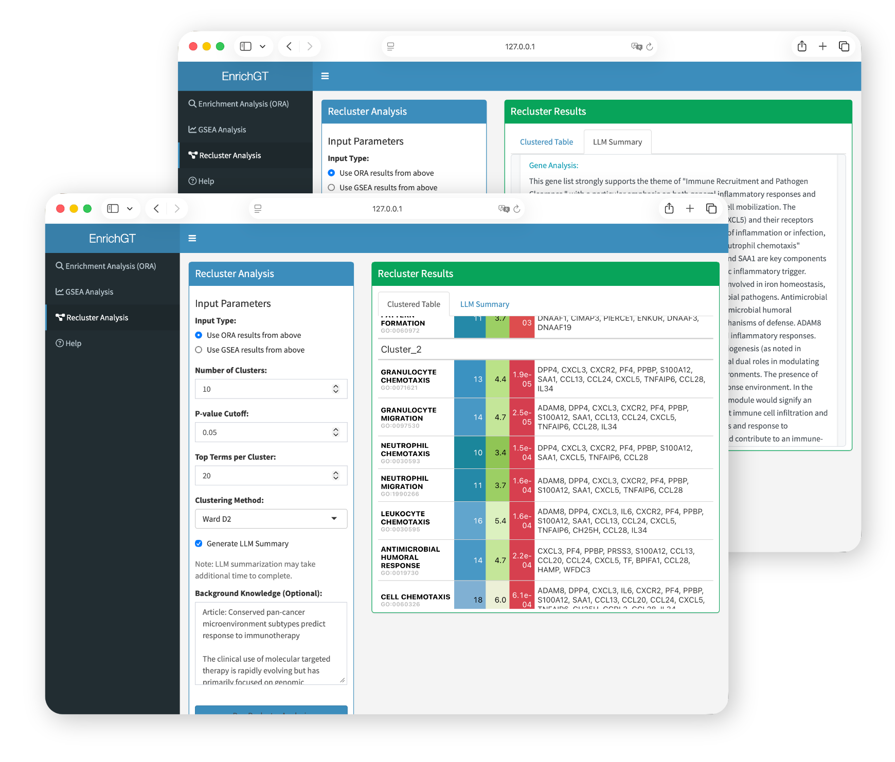

The EnrichGT Web Interface is an interactive tool that allows you to perform gene enrichment analysis through a user-friendly graphical interface, without writing code. As this tool is primarily designed for clinicians' research tasks and clinical practice, this interface provides prioritized support only for human and mouse. For other species, analysis is only available through code (in R console) or by using orthologous genes (if you still want to use webpage).



### Basic Launch

Simply run the following command in R:

```r
library(EnrichGT)
egt_web_interface()
```

This will open the web interface in your default browser automatically.

### Launch with LLM-Powered Features

The LLM function is based on package `ellmer` (<https://ellmer.tidyverse.org/index.html>). It provides a uniform interface for most of LLMs in R.

`ellmer` supports a wide variety of model providers:

-   Anthropic’s Claude: `chat_anthropic()`.
-   AWS Bedrock: `chat_aws_bedrock()`.
-   Azure OpenAI: `chat_azure_openai()`.
-   Databricks: `chat_databricks()`.
-   DeepSeek: `chat_deepseek()`.
-   GitHub model marketplace: `chat_github()`.
-   Google Gemini: `chat_google_gemini()`.
-   Groq: `chat_groq()`.
-   Ollama: `chat_ollama()`.
-   OpenAI: `chat_openai()`.
-   OpenRouter: `chat_openrouter()`.
-   perplexity.ai: `chat_perplexity()`.
-   Snowflake Cortex: `chat_snowflake()` and `chat_cortex_analyst()`.
-   VLLM: `chat_vllm()`.

You can generate a model in R environment like this (Please refer to `ellmer` website):

``` r
library(ellmer)
dsAPI <- "sk-**********" # your API key
chat <- chat_deepseek(api_key = dsAPI, model = "deepseek-chat", system_prompt = "")
```

Some suggestions:

1.  You may choose a cost-effective LLM model, as this type of annotation requires multiple calls. Also, make sure that both the LLM and the network are as stable as possible in order to obtain all the results (although `EnrichGT` has already been set to automatically retry multiple times).
2.  Non-reflective models or fast-thinking models are generally better. Slow-thinking models (such as `DeepSeek-R1`) may result in long waiting times.
3.  It is best to choose an LLM model that is relatively intelligent, has a substantial knowledge base, and exhibits low hallucination rates. In our (albeit limited) experience, although `GPT-4o` performs worse than `DeepSeek-V3-0324` in most benchmark tests, it may produce more reliable results in some cases due to the latter’s higher hallucination rate. You are free to choose whichever large model you prefer.
4.  **NO** system prompts. And please adjust your LLM's tempretures according to your provider carefully. 


If you want to enable LLM-assisted result interpretation:

```r
library(ellmer)

# Set up your LLM chat (e.g., DeepSeek)
chat <- chat_deepseek(api_key = "your_api_key", model = "deepseek-chat")

# Launch with LLM support
egt_web_interface(LLM = chat)
```

For detailed function documentation, see `?egt_web_interface`


