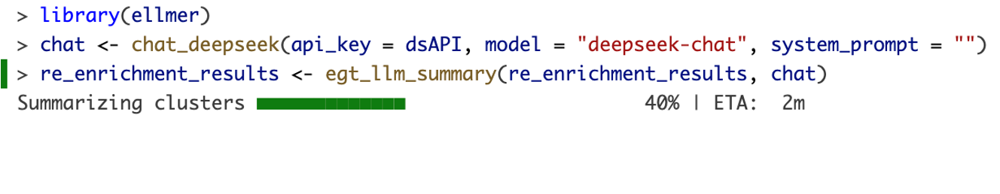
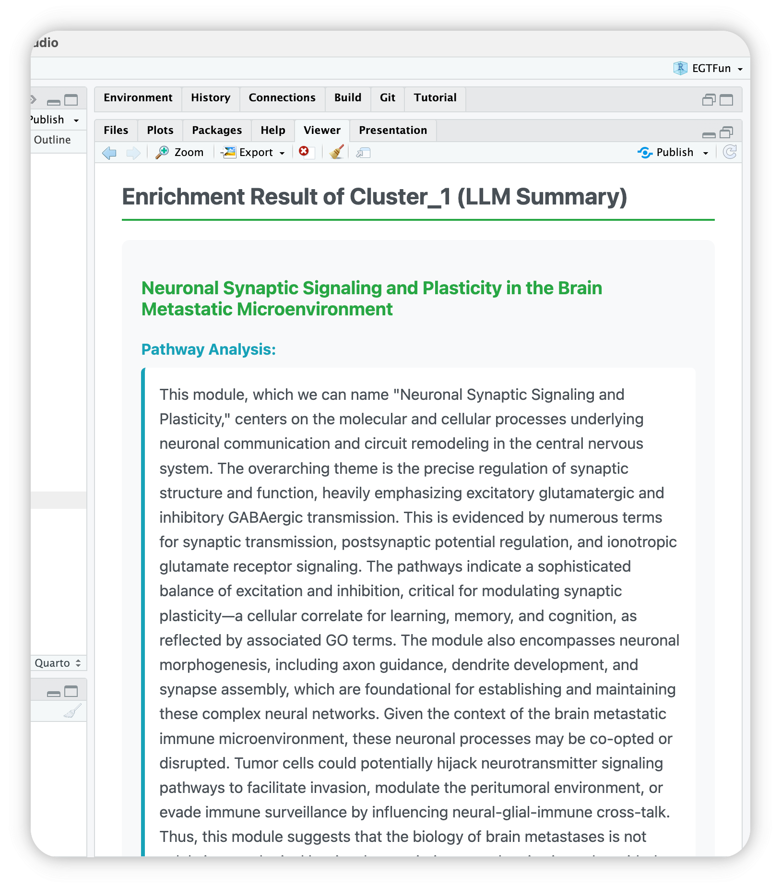
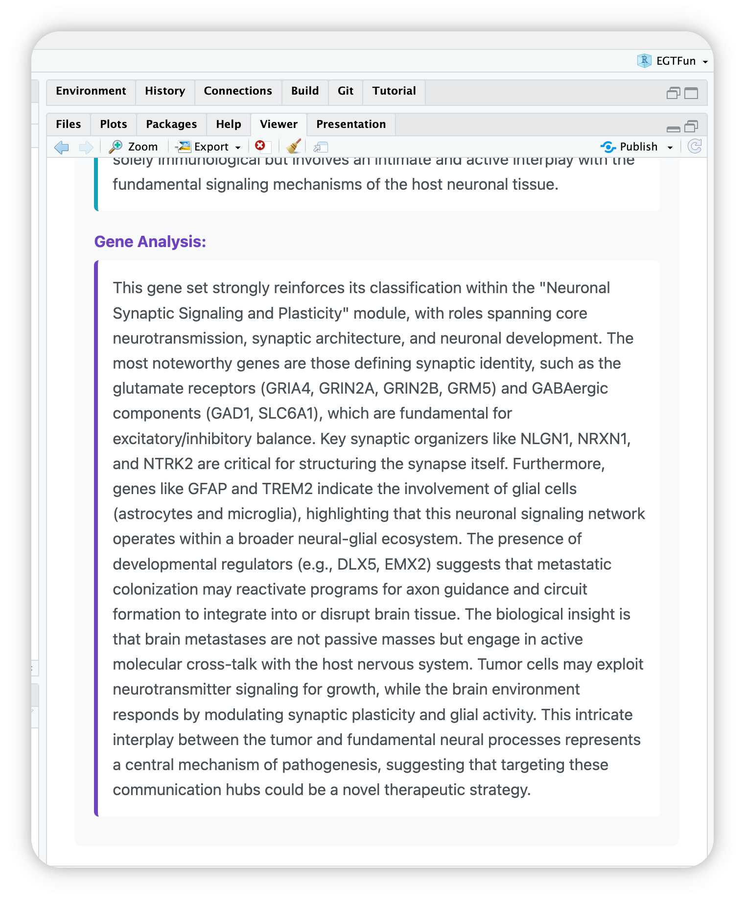
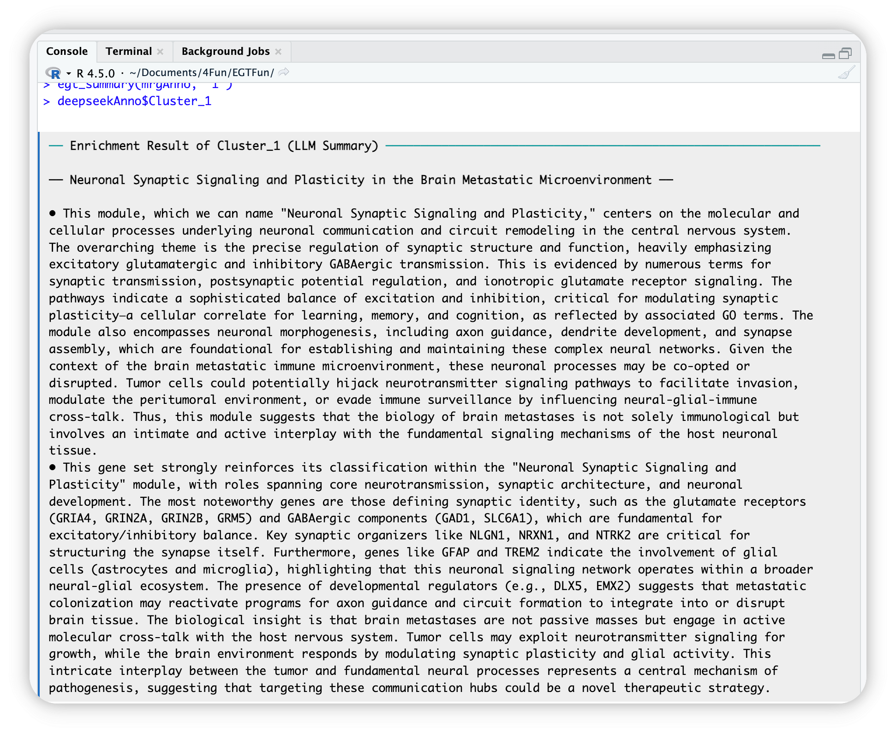
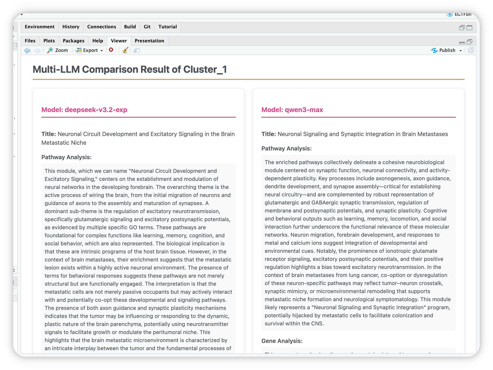

# Background

Large language models (LLMs) hold promise for interpreting biological data, yet their effectiveness is constrained when directly handling raw gene input or complex enrichment analysis results.

**Challenges in Direct LLM Interpretation**

1.  **Raw Gene Input Limitations:**
    -   LLMs exhibit suboptimal performance when provided solely with gene symbols or identifiers (e.g., TP53, BRCA1, EGFR).
    -   Without additional biological metadata, LLMs struggle to establish meaningful biological contexts and infer functional relationships among genes.
2.  **Overwhelming Enrichment Results:**
    -   Directly feeding complete outputs from Gene Ontology (GO) or Kyoto Encyclopedia of Genes and Genomes (KEGG) enrichment analyses into LLMs typically introduces excessive noise.
    -   Context window limitations result in significant information loss, hindering the accurate interpretation of complex enrichment data.
    -   Dense, unstructured enrichment tables challenge LLMs' ability to effectively prioritize and summarize critical biological insights.

**Proposed Solution: Cluster-First Approach**

To address these challenges, cluster-first methodology, exemplified by `EnrichGT`, is recommended. `EnrichGT` organizes enrichment results into meaningful clusters, thereby simplifying complexity and enhancing interpretability. Recently, `EnrichGT` has integrated support for LLM-driven interpretation, enabling LLMs to more effectively extract, summarize, and contextualize key biological insights from enrichment data.

# How to use

## Bring your LLM to R

The LLM function is based on package `ellmer` (<https://ellmer.tidyverse.org/index.html>). It provides a uniform interface for most of LLMs in R.

`ellmer` supports a wide variety of model providers:

-   Anthropic’s Claude: `chat_anthropic()`.
-   AWS Bedrock: `chat_aws_bedrock()`.
-   Azure OpenAI: `chat_azure_openai()`.
-   Databricks: `chat_databricks()`.
-   DeepSeek: `chat_deepseek()`.
-   GitHub model marketplace: `chat_github()`.
-   Google Gemini: `chat_google_gemini()`.
-   Groq: `chat_groq()`.
-   Ollama: `chat_ollama()`.
-   OpenAI: `chat_openai()`.
-   OpenRouter: `chat_openrouter()`.
-   perplexity.ai: `chat_perplexity()`.
-   Snowflake Cortex: `chat_snowflake()` and `chat_cortex_analyst()`.
-   VLLM: `chat_vllm()`.

You can generate a model in R environment like this (Please refer to `ellmer` website):

``` r
library(ellmer)
dsAPI <- "sk-**********" # your API key
chat <- chat_deepseek(api_key = dsAPI, model = "deepseek-chat", system_prompt = "")
```

Some suggestions:

1.  You may choose a cost-effective LLM model, as this type of annotation requires multiple calls. Also, make sure that both the LLM and the network are as stable as possible in order to obtain all the results (although `EnrichGT` has already been set to automatically retry multiple times).
2.  Non-reflective models or fast-thinking models are generally better. Slow-thinking models (such as `DeepSeek-R1`) may result in long waiting times.
3.  It is best to choose an LLM model that is relatively intelligent, has a substantial knowledge base, and exhibits low hallucination rates. In our (albeit limited) experience, although `GPT-4o` performs worse than `DeepSeek-V3-0324` in most benchmark tests, it may produce more reliable results in some cases due to the latter’s higher hallucination rate. You are free to choose whichever large model you prefer.
4.  **NO** system prompts. And please adjust your LLM's tempretures according to your provider carefully.

LLM-generated interpretations should be subject to expert review and literature validation, as is standard practice in computational biology workflows.

## Summrize your results using LLM

Just execute:

``` r
chat <- chat_deepseek(api_key = dsAPI, model = "deepseek-chat", system_prompt = "")
re_enrichment_results <- egt_llm_summary(re_enrichment_results, chat)
```

{width="700"}

A typical run in `DeepSeek-V3-0324` will use \~ 3 mins.

::: callout-tip
### Use backgrounds knowledge to assist LLMs

You can use `background_knowledges` to add background knowledge for LLMs to refer (e.g, papers, your opinions ...). Please paste them into a single character (string) value and pass it into EnrichGT. For example:

``` r
chat <- chat_deepseek(api_key = dsAPI, model = "deepseek-chat", system_prompt = "")
re_enrich_anno_with_ref <- egt_llm_summary(re_enrichment_results, chat, background_knowledges = paste(readLines("paperReference.txt"), collapse = " "))
```
:::

## Access Results

### Through Morden IDEs

EnrichGT works well with IDEs `RStudio` and `Positron`. You can use `egt_summary()` function to see the LLM summaries.

For example, if you want to view `cluster 1`, you can use one of below:

``` r
egt_summary(deepseekAnno, "1")
egt_summary(deepseekAnno, 1)
egt_summary(deepseekAnno, "Cluster_1")
```

Then you can see your IDE's Viewer will automaticlly open and show a HTML page.

::::: columns
::: {.column width="50%"}

:::

::: {.column width="50%"}

:::
:::::

### Through R Console

In console, after complete, you can use `$` operator to access annotated results. For example, the annotation of `Cluster_1`:

{width="700"}

``` r
llm_annotated_obj$Cluster_1
```



# Compare annotations from different LLMs

There's an old Chinese saying: 'Listening to all sides brings enlightenment.' A single LLM may lead to misunderstandings due to model limitations, but as another saying goes, 'Three cobblers with their wits combined equal Zhuge Liang the master strategist'—meaning collective wisdom surpasses individual brilliance. Therefore, we provide the functionality to compare multiple LLMs.

``` r
Compare_anno <- egt_llm_multi_summary(
  re_enrich, 
  chat_list = list(
    `deepseek-v3.2-exp` = deepseekAI, 
    `qwen3-max` = QwenAI), 
  background_knowledges = paste(readLines("paperReference.txt"), collapse = " "))

egt_summary(Compare_anno, "1") # Show results
```


